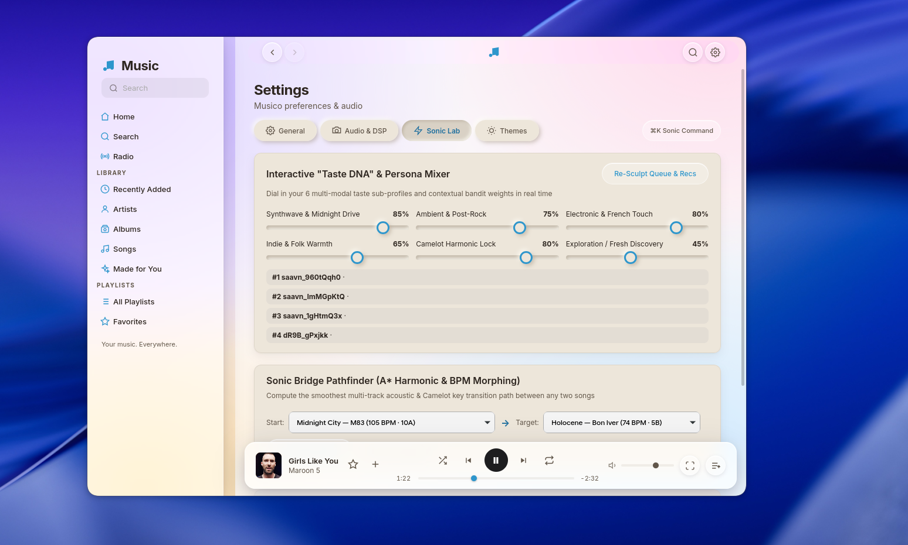
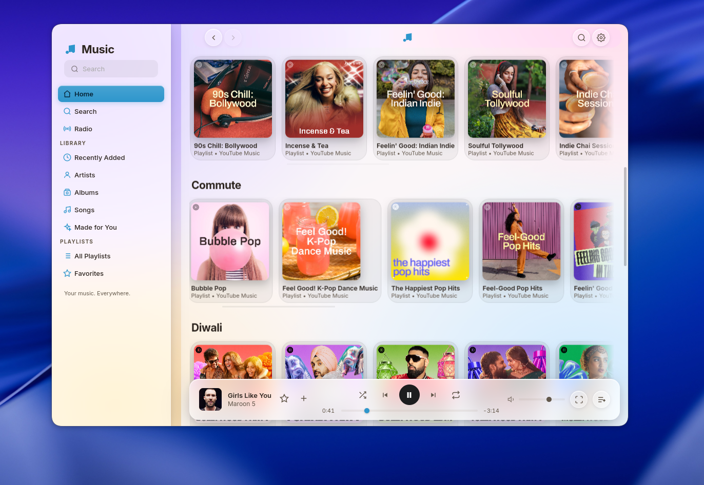
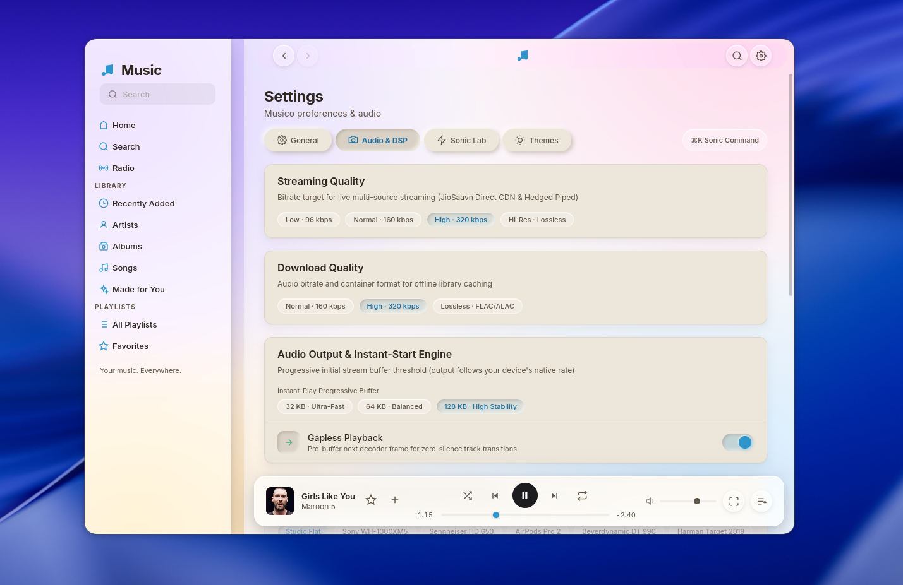
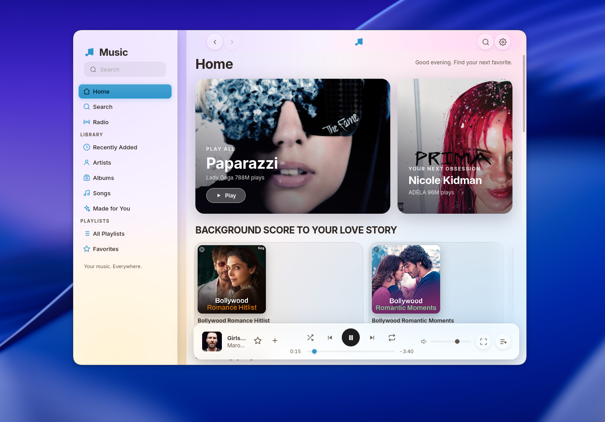
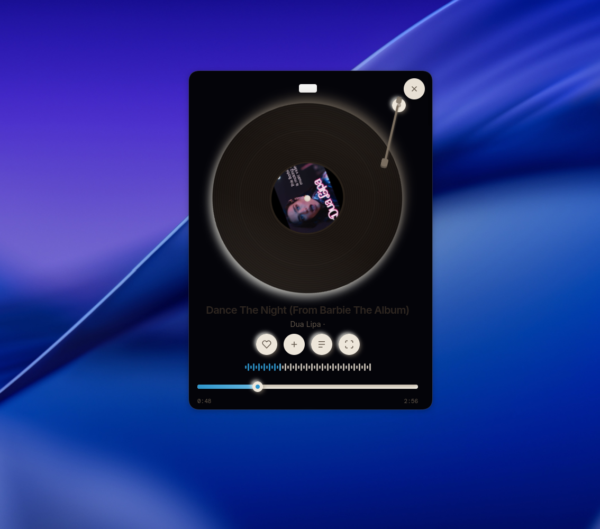
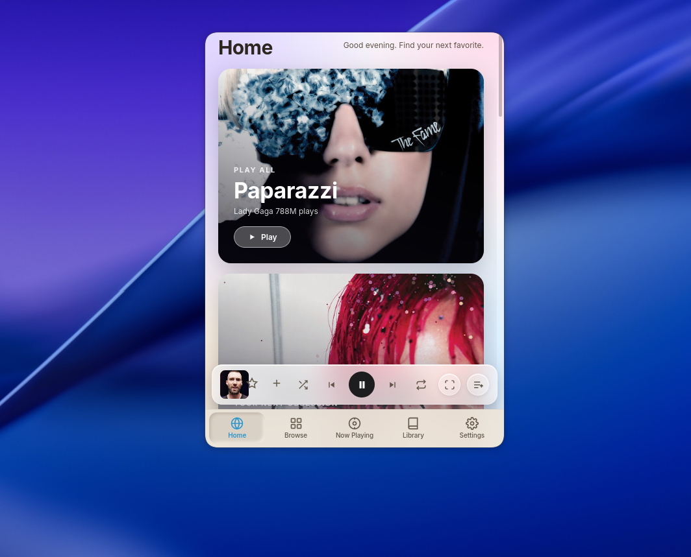
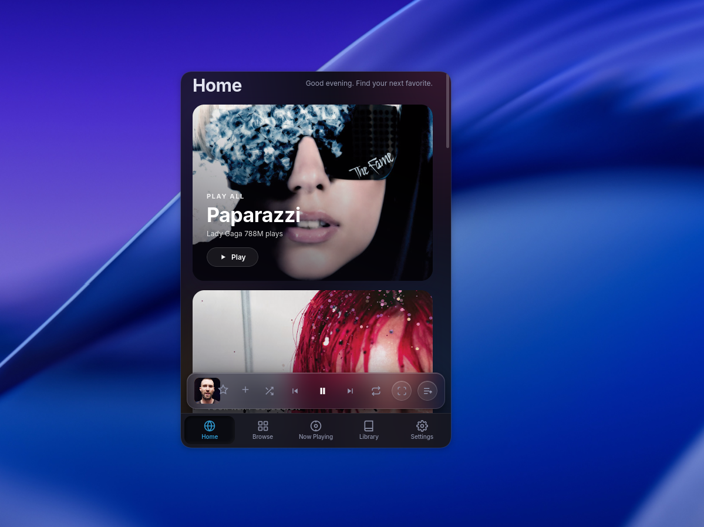

<p align="center">
  
</p>

# Musico Online

**A local-first, Material 3 Expressive music player with free online music.**
Music0 (Musico Online) is a **Compose Multiplatform** app for **Android**,
**Linux**, **macOS**, and **Windows**, backed by a pure-Rust JNI core
(`musico_core`) combining a real audio engine, a local taste engine, and an
online catalog layer for YouTube Music and JioSaavn.

> **disclaimer**
> this project is provided for educational and personal use only. i am not responsible for how anyone uses it. downloading copyrighted content without authorization may violate the law in your country. use at your own risk.

The streaming layer uses the same public technique as Metrolist / InnerTune /
RiMusic (InnerTube + direct-URL resolvers + optional `yt-dlp`). It lives here,
**not** in the offline Musico release, and is intended for personal use.

**Status:** **v1.0.0** · All-in Compose Multiplatform (Android + Linux · macOS ·
Windows) · pure-Rust `musico_core` JNI engine · installable mobile PWA preview.

<p align="center">
  
  
  <br/>
  
  
  <br/>
  
  
  <br/>
  
  
</p>

## What it does

- **Search and play millions of tracks** through YouTube Music's InnerTube
  catalog, with Songs/Videos filters, continuations, and live typeahead.
- **JioSaavn as a second catalog and stream source** — direct AAC URLs up to
  320 kbps (quality-tier dependent), merged into the first search page.
- **Tiered stream resolution** — cache → exact JioSaavn cross-source match →
  Piped/Invidious/InnerTube Direct fast path → `yt-dlp` fallback. One audio
  path: every result becomes a local file played by the same engine as your
  library.
- **Browse everything** — Home shelves, mood/genre grid, album, artist, and
  playlist detail pages, related tracks, and YouTube Music radio.
- **A real library** — local folder scanning, saved albums/artists/tracks,
  playlists, favorites, recently added, and A–Z views.
- **Downloads that behave** — single-track and batch downloads, two concurrent
  resolves, persistent pending work, retry/resume, a 1 GB LRU cache (cap
  configurable), and an Airplane Mode that fast-fails online features and
  queues work.
- **Lyrics** — unsynced YouTube Music text plus LRCLIB synced lyrics with
  karaoke highlighting, optional romanization and translation.
- **Playback depth** — gapless playback, crossfade, EQ, loudness
  normalization, AutoEQ profiles, and a local recommender v2 that learns from
  listens, skips, likes, artists, context, and audio features.
- **Playlist import** — bring playlists from public Spotify or Apple Music
  links, or exported CSV (Exportify / TuneMyMusic / Soundiiz), JSON, and
  M3U/M3U8 files with live track matching and an unmatched summary.
- **Native everywhere it can be** — one shared Material 3 Expressive Compose
  Multiplatform app on Android (Media3 ExoPlayer + AudioFX EQ) and Desktop JVM
  (Linux, macOS, Windows with Rust `musico_playback` + 10-band DSP EQ), backed
  by the pure-Rust `musico_core` JNI library.

## Install

Download the latest bundles from
[GitHub Releases](https://github.com/ARYAN007H/Music0/releases/latest).

| Platform | Artifacts |
|---|---|
| **Android (aarch64)** | Signed `musico-online-native-aarch64.apk` |
| **Linux x86_64** | `music0-linux-x86_64.deb`, `music0-linux-x86_64.rpm`, or portable `music0-linux-x86_64.tar.gz` |
| **macOS Apple Silicon** | `Music0-macos-arm64.dmg` or `Music0-macos-arm64.app.tar.gz` |
| **Windows x86_64** | `Music0-windows-x86_64.msi` or portable `Music0-windows-x86_64.zip` |
| **iOS / mobile web** | Open the web preview in Safari/Chrome and use **Add to Home Screen** |

The macOS and Windows builds are **not code-signed**. On macOS, right-click the
app → **Open** on first launch, or run:

```sh
xattr -cr "/Applications/Music0.app"
```

Windows SmartScreen may show a warning for the unsigned installer.

### Verify your download

Every release publishes `SHA256SUMS.txt`, and the Android APK is scanned on
[VirusTotal](https://www.virustotal.com) (v1.0.0: **0/66 detections**).
On Android, Google Play Protect may show *"Harmful app blocked"* on install —
that's a false positive for any self-distributed FOSS app: tap
**Install anyway**, or verify the file yourself first. Full guide:
[docs/verify-downloads.md](docs/verify-downloads.md).

### Requirements

- A desktop session with a working audio output device.
- Network access to `music.youtube.com` and the configured stream sources.
- **`yt-dlp` on `PATH`** is strongly recommended. Playback works without it
  while a direct-URL source is healthy, but `yt-dlp` is the honest last resort.
  - Arch: `sudo pacman -S yt-dlp`
  - Debian/Ubuntu: `sudo apt install yt-dlp`
  - macOS: `brew install yt-dlp`
  - Windows: `winget install yt-dlp.yt-dlp`

Keep `yt-dlp` updated — YouTube extraction changes frequently.

## Build from source

Prerequisites: Rust stable (MSRV 1.78), Java 17+, Gradle 8.10.2, Android SDK/NDK
(for Android builds), and Node.js 20+ (only for the optional web preview/tests).
On Linux, install `libasound2-dev pkg-config` (no WebKitGTK/GTK required).

```sh
git clone https://github.com/ARYAN007H/Music0.git
cd Music0

# 1. Build the pure-Rust JNI core library
cargo build --release -p musico_core --lib

# 2. Run the Compose Multiplatform Desktop app (auto-discovers target/release)
gradle -p android :desktopApp:run
```

### Packaging Desktop installers (Compose Multiplatform)

Stage the compiled Rust core into `android/desktopApp/resources/<os>/` so it is
bundled inside the native package, then build the OS distribution:

```sh
# Linux (deb / rpm / distributable)
cp target/release/libmusico_online_lib.so android/desktopApp/resources/linux/
gradle -p android :desktopApp:packageDeb :desktopApp:packageRpm :desktopApp:createDistributable

# macOS (dmg)
cp target/release/libmusico_online_lib.dylib android/desktopApp/resources/macos/
gradle -p android :desktopApp:packageDmg

# Windows (msi)
cp target/release/musico_online_lib.dll android/desktopApp/resources/windows/
gradle -p android :desktopApp:packageMsi
```

### Android APK (Compose Multiplatform)

```sh
# 1. Cross-compile musico_core for arm64-v8a
(cd musico_core && cargo ndk -t arm64-v8a -o ../android/app/src/main/jniLibs build --release --lib)

# 2. Assemble APK
gradle -p android :app:assembleDebug
```

### Web / PWA preview

The Express + TypeScript runtime is a demo and UI development environment, not
the production backend:

```sh
npm run dev              # http://localhost:3000
PORT=8143 npm run dev    # port used by the browser suites
```

It serves the same `frontend/` assets with a seeded catalog and synthesized
audio, and binds `0.0.0.0`. Do not expose it to an untrusted network.

## How playback works

Streaming is deliberately boring: resolve a track to a file, then hand that
file to the offline audio engine.

```text
search / browse / radio
        │
        ▼
   OnlineTrack { source, video_id, metadata }
        │
        ▼
 resolve_track()
   1. stream-cache hit
   2. exact JioSaavn cross-source match (YouTube tracks)
   3. Piped / Invidious / InnerTube Direct fast path (~10 s budget)
   4. yt-dlp (interactive: 1 × 90 s; background: 2 × 120 s)
        │
        ▼
   verified local file  →  musico_playback  →  speakers
```

- The cache lives at `~/.cache/musico-online/online/` and is pruned LRU to a
  configurable cap (1 GB default, `MUSICO_ONLINE_CACHE_MB` or the Storage
  settings slider override).
- A global cap of three `yt-dlp` children prevents interactive, pre-resolve,
  batch, and radio-warmup work from stacking.
- Downloads write a `.part` file, verify a minimum size, then rename
  atomically, so a killed process cannot publish a truncated track. Duration is
  probed when the search metadata lacks it.
- Online radio warms the next pick while the current track plays; autoplay and
  warmup are both gated by the Autoplay setting.

The full ladder, source trust model, and failure behavior are documented in
[docs/online-stack.md](docs/online-stack.md).

## Testing

```sh
# What CI runs: 172 collected tests, 13 live tests ignored by default
cargo test --workspace --exclude musico_playback

# Full workspace: 189 tests, including playback end-to-end (needs an audio device)
bash scripts/gen_test_tone.sh
cargo test --workspace

# TypeScript engine: 20 tests + typecheck
npm test
npm run build

# Shared Compose Multiplatform unit tests (JVM)
gradle -p android :shared:desktopTest

# Opt-in live network tests
MUSICO_LIVE_TESTS=1 cargo test -p musico_core live_ -- --ignored --nocapture
```

Browser suites and the WCAG contrast gate are documented in
[docs/testing.md](docs/testing.md). They expect the web preview on port 8143
(contrast gate: 8145) and Playwright + Chrome installed locally.

## Documentation

| Document | Contents |
|---|---|
| [ARCHITECTURE.md](ARCHITECTURE.md) | System design, threads, crate boundaries, flows, failure model, budgets |
| [CONTRIBUTING.md](CONTRIBUTING.md) | Setup, branch/PR workflow, commits, testing, standards, multi-agent rules |
| [docs/](docs/README.md) | Deep dives: development, testing, frontend, online stack, storage, IPC, release, troubleshooting |
| [docs/adr/](docs/adr/README.md) | Architecture decision records and their rationale |
| [SECURITY.md](SECURITY.md) | Supported versions, threat model, reporting, privacy |
| [CHANGELOG.md](CHANGELOG.md) | Release history through v1.0.0 |
| [ROADMAP.md](ROADMAP.md) | Plan of record and remaining phases |
| [CODE_OF_CONDUCT.md](CODE_OF_CONDUCT.md) | Contributor Covenant 2.1 |

## Project layout

```text
android/              Compose Multiplatform app (:shared UI/ViewModel, :app Android, :desktopApp JVM)
musico_core/          Pure-Rust JNI core (`mobile.rs`), online stack, lyrics, config, identity
musico_playback/      Audio engine: decoder, CPAL output, queue, 10-band DSP EQ
musico_recommender/   Local recommender + sled persistence
frontend/             Optional web/PWA preview UI
src/engine/           TypeScript engine for the web/PWA preview
server.ts             Express demo runtime (not the production backend)
scripts/              Browser suites, contrast gate, test-tone generator
docs/                 Deep dives and ADRs
.github/              CI/release workflows, issue and PR templates
```

## Contributing

Every change lands as **branch → PR → CI → independent review → merge** —
never directly on `main`. Good first targets are frontend polish, catalog
surfaces, tests, and documentation; the Rust playback core is intentionally
conservative.

Read [CONTRIBUTING.md](CONTRIBUTING.md) before opening a PR. Human PRs go
through the same review gate as agent PRs. The repository runs a multi-agent
experiment coordinated through the tracked [agentchat.md](agentchat.md) hub;
you do not need to participate in it to contribute.

- Bug reports and feature requests: use the issue templates.
- Security issues: **do not open a public issue** — follow [SECURITY.md](SECURITY.md).
- Community expectations: [CODE_OF_CONDUCT.md](CODE_OF_CONDUCT.md).

## Known limitations

- **Online sources are unofficial.** InnerTube response shapes, instance
  availability, and YouTube extraction can change without notice. `yt-dlp`
  needs regular updates; the direct sources and JioSaavn absorb some outages.
- **Cross-source matching is heuristic.** A YouTube track is mapped to
  JioSaavn by title, artist token, and a ±4 s duration window. If the wrong
  take is picked, there is no per-track override in v0.7.0; report the
  YouTube id and the Saavn id so the matching heuristic can be fixed.
- **Quality is source-bounded.** `lossless` means "best available from the
  source", not a guarantee of a lossless master.
- **Prebuilt macOS/Windows artifacts are unsigned.** Gatekeeper and SmartScreen
  will warn on first launch.
- **No cloud account or sync.** Library metadata, settings, playlists, likes,
  and history stay on the machine.
- **Android APK is published directly in GitHub Releases** alongside Linux,
  macOS, and Windows Compose Multiplatform Desktop packages.
- **The web preview is not the app.** It has a demo backend, a seeded catalog,
  and synthesized audio. Use the Compose Multiplatform builds for real playback.

## License

MIT — see [LICENSE](LICENSE).
