<p align="center">
  
</p>

# Music0

**An online music streaming app built with Compose Multiplatform and a pure-Rust JNI core.**
Music0 (Musico Online) is a **Compose Multiplatform** app for **Android**,
**Linux**, **macOS**, and **Windows**, backed by a pure-Rust JNI core
(`musico_core`) combining a real audio engine (`musico_playback`), a local taste
recommender (`musico_recommender`), and an online catalog & streaming stack for
YouTube Music and JioSaavn — with zero Tauri or WebView dependencies.

> **disclaimer**
> this project is provided for educational and personal use only. i am not responsible for how anyone uses it. downloading copyrighted content without authorization may violate the law in your country. use at your own risk.

The streaming layer uses the same public technique as Metrolist / InnerTune /
RiMusic (InnerTube + direct-URL resolvers + optional `yt-dlp`). It is built
for online streaming and personal use.

**Status:** **v1.0.2** · All-in Compose Multiplatform (Android + Linux · macOS ·
Windows) · pure-Rust `musico_core` JNI engine.

<p align="center">
  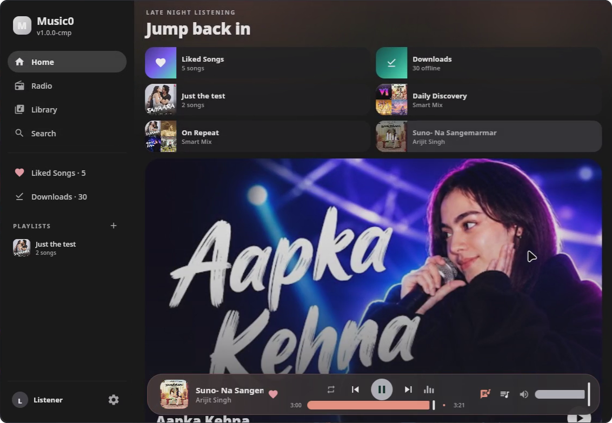
  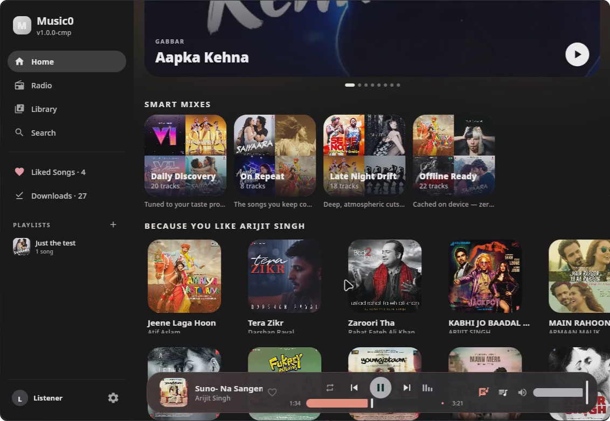
  <br/>
  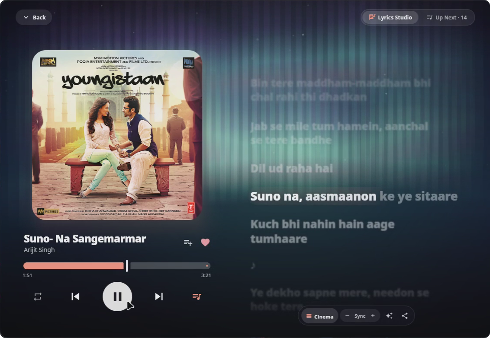
  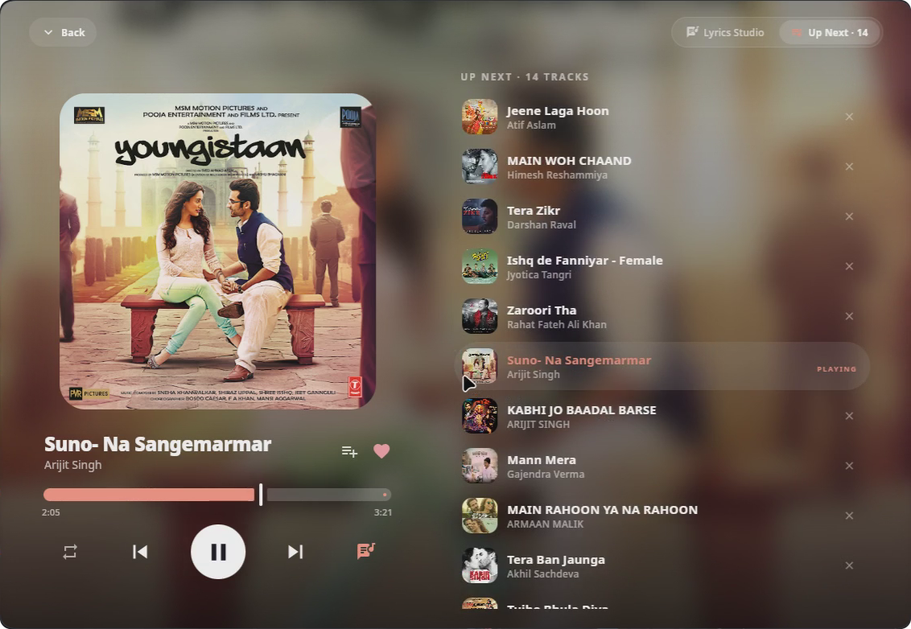
  <br/>
  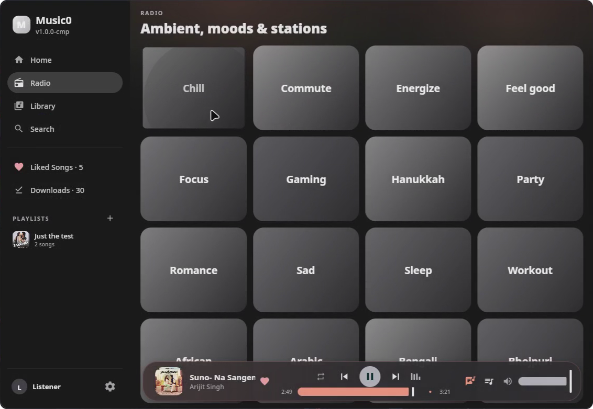
  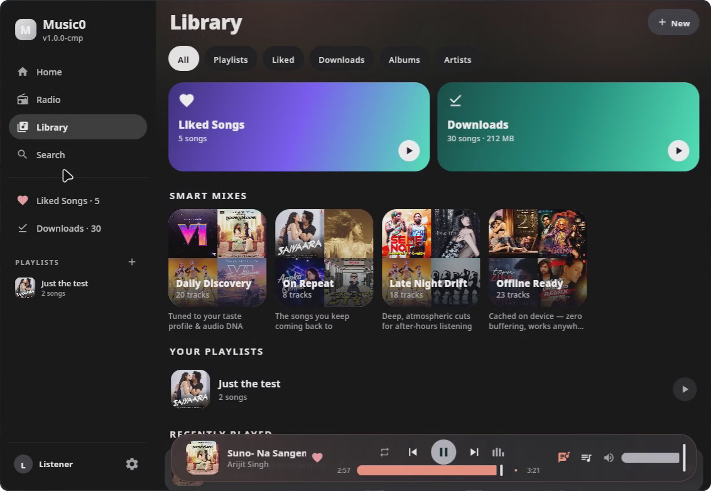
  <br/>
  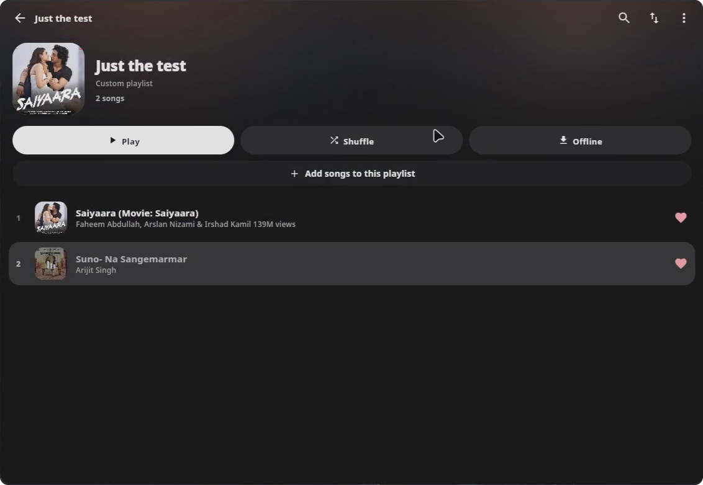
  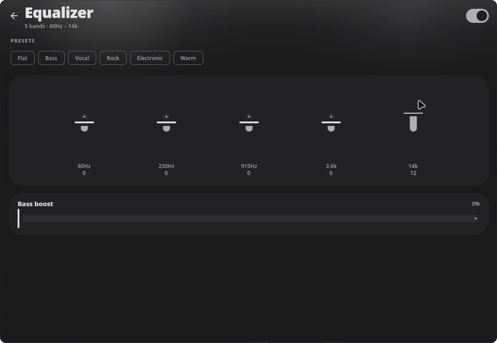
  <br/>
  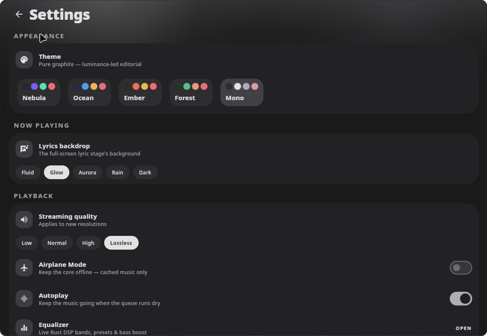
  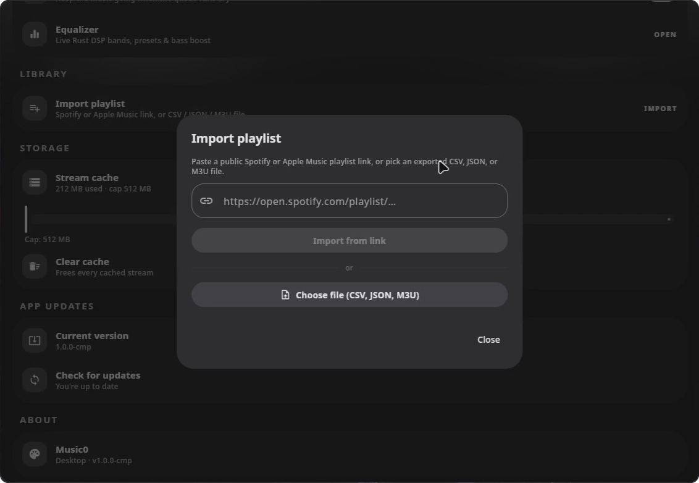
  <br/>
  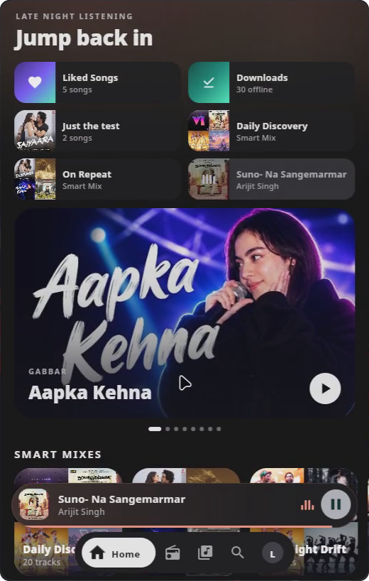
  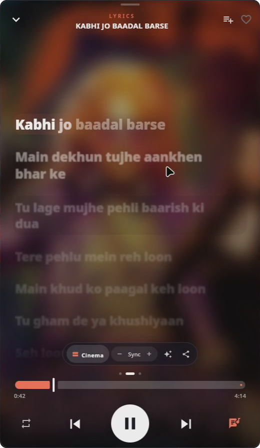
</p>

## What it does

- **Search and play millions of tracks** through YouTube Music's InnerTube
  catalog, with live typeahead suggestions and recent searches.
- **JioSaavn as a second catalog and stream source** — direct AAC URLs up to
  320 kbps (quality-tier dependent), merged into search results and raced
  against InnerTube for fast track resolution.
- **Tiered stream resolution & stream-while-downloading** — cache hit → parallel
  JioSaavn cross-source match vs. InnerTube Direct / Piped / Invidious hedged
  fast path → `yt-dlp` fallback (Desktop). A loopback HTTP/1.1 range server
  (`127.0.0.1`) streams from `.part` files as bytes arrive (16 KiB startup
  gate) before atomically committing tracks to disk.
- **Home & Radio discovery** — dynamic time-of-day Home feed with *Jump back
  in* quick picks, auto-advancing Hero Carousel, Smart Mixes, and personalized
  shelves; **Radio** mood & genre station grid; and collapsing parallax album,
  artist, playlist, and genre detail pages.
- **On-device Library & Smart Mixes** — Liked Songs, Offline Downloads, User
  Playlists (with 2×2 cover mosaics, create/rename/reorder), auto-updating Rust
  Smart Mixes, Saved Albums & Followed Artists, and Recently Played / Up Next
  queue.
- **Downloads & smart LRU cache** — single-track and batch downloads, two
  concurrent resolves, persistent pending work, `{stem}.meta.json` metadata
  sidecars, a configurable LRU stream cache (512 MB–5120 MB slider in Settings,
  1 GB default), and Airplane Mode for offline cached playback.
- **Lyrics Studio** — synced LRCLIB lyrics with YouTube Music fallback,
  **Cinema** (*Flowing Verse*) and **Stage** (*Kinetic*) display modes,
  tap-to-seek, timing offset controls, optional romanization and translation
  sub-lines, shareable Lyric Cards (up to 4 lines), and 5 ambient backdrops
  (**Fluid**, **Glow**, **Aurora**, **Rain**, **Dark**).
- **Audio & Equalizer** — gapless playback, Autoplay, Skip Silence and
  Playback Speed (`0.75×`–`2×`) on Android, and a 5-band Equalizer
  (`60Hz`–`14kHz`) with 6 presets (**Flat**, **Bass**, **Vocal**, **Rock**,
  **Electronic**, **Warm**) and Bass Boost — powered by Media3 ExoPlayer +
  Android AudioFX on Android, and Symphonia + CPAL + 10-band biquad DSP EQ
  (with AutoEQ and loudness normalization support in `musico_playback`) on
  Desktop.
- **Playlist import** — bring playlists from public Spotify
  (`open.spotify.com/playlist/...`) or Apple Music
  (`music.apple.com/.../playlist/...`) links, or exported CSV (Exportify /
  TuneMyMusic / Soundiiz), JSON, and M3U/M3U8 files with live `"Matching X of M…"`
  progress and an unmatched-tracks summary.
- **Material 3 Expressive across Android & Desktop** — 5 curated palettes
  (**Nebula**, **Ocean**, **Ember**, **Forest**, **Mono**) with **System**,
  **Light**, and **Dark** `ThemeMode`s, zero-blur / zero-gradient solid M3E tonal
  surfaces and geometric backdrops, expressive controls & scalloped shapes,
  adaptive layout (`< 840 dp` compact capsule nav + mini-player; `≥ 840 dp`
  sidebar rail + floating squircle player dock + split-stage Now Playing +
  keyboard shortcuts), and a local Rust taste recommender (`musico_recommender` + `sled`).

## Install

Download the **v1.0.2** bundles from
[GitHub Releases](https://github.com/ARYAN007H/Music0/releases/latest).

| Platform | Artifacts |
|---|---|
| **Android (aarch64)** | Signed `musico-online-native-aarch64.apk` |
| **Linux x86_64** | `music0-linux-x86_64.deb`, `music0-linux-x86_64.rpm`, `music0-linux-x86_64.AppImage`, `music0-linux-x86_64.flatpak`, or portable `music0-linux-x86_64.tar.gz` |
| **macOS Apple Silicon** | `Music0-macos-arm64.dmg` or `Music0-macos-arm64.app.tar.gz` |
| **Windows x86_64** | `Music0-windows-x86_64.msi` or portable `Music0-windows-x86_64.zip` |

The macOS and Windows builds are **not code-signed**. On macOS, right-click the
app → **Open** on first launch, or run:

```sh
xattr -cr "/Applications/Music0.app"
```

On Windows, click **More info → Run anyway** if SmartScreen prompts for the
unsigned installer.

### Verify your download

Every release publishes `SHA256SUMS.txt`, and APKs are scanned on
[VirusTotal](https://www.virustotal.com) (reference v1.0.0 scan: **0/66 detections**).
On Android, Google Play Protect may show *"Harmful app blocked"* on install —
that's a false positive for any self-distributed FOSS app: tap
**Install anyway**, or verify the file yourself first. Full guide:
[docs/verify-downloads.md](docs/verify-downloads.md).

### Requirements

- A desktop session with a working audio output device.
- Network access to `music.youtube.com` and the configured stream sources.
- **`yt-dlp` on `PATH`** is strongly recommended. Playback works without it
  while a direct-URL source is healthy, but `yt-dlp` is the reliable fallback.
  - Arch: `sudo pacman -S yt-dlp`
  - Debian/Ubuntu: `sudo apt install yt-dlp`
  - macOS: `brew install yt-dlp`
  - Windows: `winget install yt-dlp.yt-dlp`

Keep `yt-dlp` updated — YouTube extraction changes frequently.

## Build from source

Prerequisites: Rust stable (MSRV 1.78), Java 17+, Gradle 8.10.2, and Android SDK/NDK
(for Android builds).
On Linux, install `libasound2-dev pkg-config` (no WebKitGTK/GTK required).

```sh
git clone https://github.com/ARYAN007H/Music0.git
cd Music0

# 1. Build the pure-Rust JNI core library
cargo build --release -p musico_core --lib

# 2. Run the Compose Multiplatform Desktop app (auto-discovers target/release)
gradle -p android :desktopApp:run
```

### Packaging Desktop installers (Compose Multiplatform)

Stage the compiled Rust core into `android/desktopApp/resources/<os>/` so it is
bundled inside the native package, then build the OS distribution:

```sh
# Linux (deb / rpm / distributable / AppImage / Flatpak)
mkdir -p android/desktopApp/resources/linux
cp target/release/libmusico_online_lib.so android/desktopApp/resources/linux/
gradle -p android :desktopApp:packageDeb :desktopApp:packageRpm :desktopApp:createDistributable
bash scripts/package_appimage.sh
bash scripts/package_flatpak.sh   # optional: requires flatpak & flatpak-builder

# macOS (dmg)
cp target/release/libmusico_online_lib.dylib android/desktopApp/resources/macos/
gradle -p android :desktopApp:packageDmg

# Windows (msi)
cp target/release/musico_online_lib.dll android/desktopApp/resources/windows/
gradle -p android :desktopApp:packageMsi
```

### Android APK (Compose Multiplatform)

```sh
# 1. Cross-compile musico_core for arm64-v8a
(cd musico_core && cargo ndk -t arm64-v8a -o ../android/app/src/main/jniLibs build --release --lib)

# 2. Assemble APK
gradle -p android :app:assembleDebug
```

## How playback works

Streaming resolves a track through a tiered pipeline, feeds bytes through a
loopback HTTP/1.1 range server as they download, and plays via the native audio
engine:

```text
search / browse / radio
        │
        ▼
   OnlineTrack { source, video_id, metadata }
        │
        ▼
  resolve_track()
    1. stream-cache hit
    2. exact JioSaavn cross-source match (YouTube tracks)
    3. Piped / Invidious / InnerTube Direct fast path (~10 s budget)
    4. yt-dlp (interactive: 1 × 90 s; background: 2 × 120 s)
        │
        ▼
   loopback range server / verified local file  →  musico_playback / ExoPlayer  →  speakers
```

- The stream cache lives under `~/.cache/musico-online/musico-online/online/`
  on Linux (see [docs/data-storage.md](docs/data-storage.md) for all OS paths)
  and is pruned LRU to a configurable cap (1 GB default, `MUSICO_ONLINE_CACHE_MB`
  or the Storage settings slider override, 512 MB–5120 MB).
- A global cap of three `yt-dlp` children prevents interactive, pre-resolve,
  batch, and radio-warmup work from stacking.
- Downloads write a `.part` file, verify a minimum size, write a
  `{stem}.meta.json` sidecar, and rename atomically, so a killed process cannot
  publish a truncated track. Duration is probed when search metadata lacks it.
- Online radio warms the next pick while the current track plays; autoplay and
  warmup are both gated by the Autoplay setting.

The full ladder, source trust model, and failure behavior are documented in
[docs/online-stack.md](docs/online-stack.md).

## Testing

```sh
# Rust workspace tests (CI baseline; live tests ignored by default)
cargo test --workspace --exclude musico_playback

# Full Rust workspace, including playback end-to-end (needs an audio device)
bash scripts/gen_test_tone.sh
cargo test --workspace

# Compose Multiplatform Android + Desktop compile & shared JVM unit tests
gradle -p android :app:compileDebugKotlin :desktopApp:compileKotlin :shared:desktopTest --console=plain

# Opt-in live network tests
cargo test -p musico_core live_ -- --ignored --nocapture
```

## Documentation

| Document | Contents |
|---|---|
| [ARCHITECTURE.md](ARCHITECTURE.md) | System design, threads, crate boundaries, flows, failure model, budgets |
| [CONTRIBUTING.md](CONTRIBUTING.md) | Setup, branch/PR workflow, commits, testing, standards, multi-agent rules |
| [docs/](docs/README.md) | Deep dives: development, testing, frontend, online stack, storage, IPC, release, troubleshooting |
| [docs/adr/](docs/adr/README.md) | Architecture decision records and their rationale |
| [SECURITY.md](SECURITY.md) | Supported versions, threat model, reporting, privacy |
| [CHANGELOG.md](CHANGELOG.md) | Release history through v1.0.2 |
| [ROADMAP.md](ROADMAP.md) | Post-v1.0.2 roadmap and non-goals |
| [CODE_OF_CONDUCT.md](CODE_OF_CONDUCT.md) | Community code of conduct |

## Project layout

```text
android/              Compose Multiplatform app (:shared UI/ViewModel, :app Android, :desktopApp JVM)
musico_core/          Pure-Rust JNI core (`mobile.rs`), online stack, lyrics, config, identity
musico_playback/      Audio engine: decoder, CPAL output, queue, 10-band DSP EQ
musico_recommender/   Local recommender + sled persistence
flatpak/              Linux desktop entry, AppStream metainfo, and Flatpak manifest
scripts/              AppImage/Flatpak packaging scripts and test-tone generator
docs/                 Deep dives, brand assets, screenshots, and ADRs
.github/              CI/release workflows, issue and PR templates
```

## Contributing

Every change lands as **branch → PR → CI → independent review → merge** —
never directly on `main`. Good first targets are UI polish, catalog surfaces,
tests, and documentation; the Rust playback core is intentionally conservative.

Read [CONTRIBUTING.md](CONTRIBUTING.md) before opening a PR. Human PRs go
through the same review gate as agent PRs. The repository runs a multi-agent
experiment coordinated through the tracked [agentchat.md](agentchat.md) hub;
you do not need to participate in it to contribute.

- Bug reports and feature requests: use the issue templates.
- Security issues: **do not open a public issue** — follow [SECURITY.md](SECURITY.md).
- Community expectations: [CODE_OF_CONDUCT.md](CODE_OF_CONDUCT.md).

## Known limitations

- **Online sources are unofficial.** InnerTube response shapes, instance
  availability, and YouTube extraction can change without notice. `yt-dlp`
  needs regular updates; the direct sources and JioSaavn absorb some outages.
- **Cross-source matching is heuristic.** A YouTube track is mapped to
  JioSaavn by normalized title, artist token overlap, and duration-drift
  ranking (allowing ≤ 6 s or ≤ 20% relative drift). If the wrong take is
  picked, there is no per-track override yet; report the YouTube id and the
  Saavn id so the matching heuristic can be improved.
- **Quality is source-bounded.** `lossless` means "best available from the
  source", not a guarantee of a lossless master.
- **Prebuilt macOS/Windows artifacts are unsigned.** Gatekeeper and SmartScreen
  will warn on first launch.
- **No cloud account or sync.** Library metadata, settings, playlists, likes,
  and history stay on the machine.
- **Android APK is published directly in GitHub Releases** alongside Linux,
  macOS, and Windows Compose Multiplatform Desktop packages.

## License

MIT — see [LICENSE](LICENSE).
